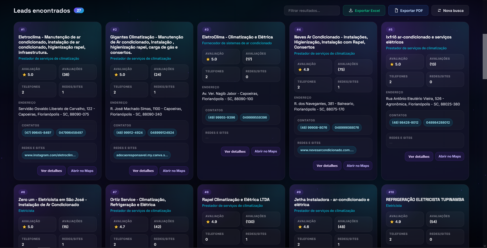

# LeadHunter — Prospecção B2B

Aplicação para pesquisar empresas no Google Maps, estruturar dados públicos de contato e exportar listas de prospecção em Excel ou PDF.


## Problema

A montagem manual de listas comerciais exige pesquisas repetitivas, cópia de dados e organização posterior. O LeadHunter automatiza esse fluxo em uma interface simples: o usuário informa o segmento e a localização, acompanha a pesquisa e recebe resultados estruturados para trabalhar.

## Funcionalidades

- Pesquisa por termo e localização.
- Automação de navegador com carregamento de conteúdo dinâmico.
- Extração de nome, categoria, endereço, telefone, site e avaliação quando disponíveis.
- Interface web para iniciar e acompanhar a coleta.
- Exportação dos resultados em XLSX e PDF.
- Scripts de instalação e inicialização para Windows.

## Arquitetura

- **FastAPI** fornece a API e serve a interface estática.
- **Playwright** controla o Chromium e interpreta páginas renderizadas por JavaScript.
- **ThreadPoolExecutor** mantém o processamento bloqueante fora do event loop.
- **OpenPyXL** e **ReportLab** geram documentos diretamente em memória.
- O frontend usa HTML, CSS e JavaScript sem etapa de build.

## Telas




## Executando localmente

Requisitos: Python 3.10+ e navegador Chromium instalado pelo Playwright.

### Windows

```bat
install.bat
start.bat
```

### Instalação manual

```bash
python -m venv .venv
pip install -r requirements.txt
playwright install chromium
uvicorn app:app --reload
```

A aplicação ficará disponível em `http://localhost:8000`.

## Uso responsável

A ferramenta trabalha com informações publicamente disponíveis. Quem utiliza o projeto é responsável por respeitar os termos dos sites consultados, a legislação aplicável e boas práticas de privacidade e contato comercial. Seletores de páginas externas podem mudar ao longo do tempo.

## Autor

Desenvolvido por [Vitor Goetmann](https://github.com/vitorgoetmann).
